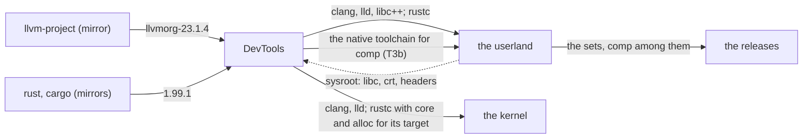

# EmiBSD DevTools

<p align="center">
  
</p>

<p align="center"><em>Ferffy, the EmiBSD mascot: a <a href="https://en.wikipedia.org/wiki/Lithodes_santolla">centolla</a>, the child of Ferris (Rust's crab) and Puffy (OpenBSD's pufferfish).</em></p>

<p align="center"><strong>The toolchains of EmiBSD, imported from the forks and built once: upstream LLVM for the C and for rustc, a pinned stable Rust, plus the patch series that teaches them the EmiBSD target.</strong></p>

<p align="center">
  <a href="LICENSE"></a>
  <a href="rust-toolchain.toml"></a>
  <a href="#milestones"></a>
  <a href="#milestones"></a>
  <a href="https://www.emibsd.org"></a>
</p>

> **Not for production.** EmiBSD is an experiment. It runs only in QEMU, and its crypto,
> network and storage code is unaudited. Do not use it to protect real data or real networks.

The toolchains of [EmiBSD](https://www.emibsd.org), both imported, both from the forks alone,
built once for every repository that needs them:

- **`llvm/`**: upstream LLVM at the tag `llvmorg-23.1.4`, from the fork `EmiBSD/llvm-project`,
  built with its own CMake: clang, lld, the tools, and compiler-rt, libunwind, libc++abi and
  libc++ for `aarch64-emibsd-emibsd8.0` and `x86_64-emibsd-emibsd8.0`, the targets our patch
  series teaches it (decisions D-0004, D-0008). Apache-2.0 with the LLVM exception. The one compiler
  of the system, and the backend of rustc.
- **`rust/`**: rust-lang/rust at the tag `1.99.1`, from the fork `EmiBSD/rust`, built with `x.py`
  against `llvm/`'s LLVM, from the vendored crates of its own `Cargo.lock`, with no network:
  rustc, cargo, rustdoc, clippy, rustfmt and `rust-src`; `std` for the host; `core` and `alloc`
  for the kernel's `aarch64-emibsd-none-softfloat` and `x86_64-emibsd-none-softfloat`; `std` for
  `aarch64-emibsd-emibsd` and `x86_64-emibsd-emibsd`, tier 3 targets that this way get their
  standard library from a stable release's source, without nightly (our patch series teaches
  rustc, std and the libc crate the targets). Apache-2.0 and MIT.

No toolchain here is ours, and nothing of it comes from OpenBSD (decision D-0003 of
`docs/DECISIONS.md`). The sources come from the read-only mirrors `llvm-project`, `rust`,
`cargo`, `backtrace-rs` and `libc`, pinned in each `UPSTREAM.toml` to what the stable release
fixes; what is ours is the build glue, the patch series that adds the EmiBSD target (ISC, each
patch with its reason: `llvm/patches/`, `rust/patches/`) and the artifacts.

The build scripts, the documents and the commits of this repository are written by Claude
Code agents under its written rules (`CLAUDE.md`, `.claude/rules/`); the maintainer, Emilio
Navarrete Lineros, takes every decision and approves every commit (`docs/POLICIES.md`).

EmiBSD is not affiliated with or endorsed by the OpenBSD project, the LLVM project or the
Rust project.

## Where it sits



DevTools knows nothing of its consumers' internals: it takes a sysroot as an input and
publishes artifacts with checksums. `docs/TOOLCHAIN.md` has the inputs, the outputs, the
hosts and the chain; `docs/DECISIONS.md` why the repository exists (D-0002) and why nothing
of OpenBSD is in it (D-0003).

## Milestones

| | Scope | Proof | State |
|---|---|---|---|
| T0 | the repository, the pins, the tools, the mirror check | `just check` green | met 2026-10-31 |
| T1 | upstream LLVM 23.1.4 built from the fork with CMake on the macOS host: the host tools, then the target runtimes | a C and a C++ hello compiled for the target run under the EmiBSD kernel in QEMU | built and checked on the host 2026-10-31 (`llvm/tests/check.sh`); the QEMU run pending |
| T2 | rustc with `x.py` against T1's LLVM, macOS host, targets `aarch64-emibsd-emibsd` and `x86_64-emibsd-emibsd` (decisions D-0004, D-0008: their target specs and `std` paths as `rust/patches/`) and the kernel's `aarch64-emibsd-none-softfloat` and `x86_64-emibsd-none-softfloat` (D-0006, D-0008), the userland's sysroots | a static Rust hello runs under the EmiBSD kernel in QEMU | built and checked on the host 2026-10-31 (`rust/tests/check.sh`): rustc, the tools, `std` for the host and for `aarch64-emibsd-emibsd`, `core`/`alloc` for the kernel's target; the QEMU run pending |
| T3 | GitHub releases: one tarball per host and architecture (`arm64`, `amd64`; D-0008) with `.sha256`; consumers fetch by pin | a consumer's toolchain recipe installs it from the release | released 2026-10-31 for arm64, made again 2026-11-02 for arm64 and amd64 under the same versions (D-0008): `llvm-23.1.4+emibsd.1` (67 MB per architecture: the compiler, the linker and the binutils, `llvm/DESIGN.md`) and `rust-1.99.1+emibsd.1` (144 MB per architecture, built against it), each with its `.sha256`. The first releases of the day, at 22.1.6 and 1.98.1, were withdrawn when both pins moved the same day; the kernel had built and booted with them (its own isolated test). Since then `llvm-23.1.4+emibsd.2` (2026-11-07: lld takes the `.emibsd.*` section names, patch 0006), `+emibsd.3` (the driver's link defaults, 0007) and `+emibsd.4` with `rust-1.99.1+emibsd.2` (2026-11-09: the shared C++ runtime by the system's names, the unwinder inside libc++abi, D-0010), which the kernel and the release repository pin. The consumer's recipe pending |
| T3b | the native toolchain (D-0009): LLVM (clang, lld, `llvm-ar`, the binutils, libc++) and Rust (rustc, cargo, `std`) cross-built on the Mac for the host `aarch64-emibsd-emibsd8.0`, then amd64, one artifact per architecture; the userland puts it in its `comp` set | under the EmiBSD kernel in QEMU, the native clang compiles and links a C and a C++ hello, `llvm-ar` builds an archive, the native rustc builds a Rust hello | released 2026-11-11 as `llvm-23.1.4+emibsd.5` and `rust-1.99.1+emibsd.3` (native artifacts, the EmiBSD triple as host, handed to the userland for comp): arm64 proven under the EmiBSD kernel in QEMU (the kernel's harness, 2026-11-11: the native cc, c++, ar and rustc built and ran their programs); amd64 checked statically, its QEMU run waiting for the kernel's amd64 boot |
| T4 | self-hosted: rustc built on EmiBSD with T3b as stage0 | after the kernel's N9, when no inherited tree is left | |

## Using it

```
just status          # the two toolchains, their STATUS and version
just mirror-check    # every pin exists on its mirror and its origin with the same hash
just outdated        # is any pin behind its upstream's latest release? (the daily workflow files an issue)
just fetch           # clone the pinned sources into upstream/ (network)
just fetch-check     # the fetched sources match the pins
just build llvm      # build one toolchain into target/ (long: built once, cached; under /tmp/emibsd/ci.lock); `just build rust` after it
just crates rust     # the licences of the vendored crates, against docs/POLICIES.md
just dist llvm       # the artifact: dist/<name>-<version>-<host>.tar.zst and .sha256, checked unpacked elsewhere
just release llvm    # the GitHub release from a tagged commit (the maintainer's)
just check           # what costs nothing: pins, mirrors, licences, scripts
```

`docs/TOOLCHAIN.md` has the hosts, the targets, the stage0 chain and the artifact format;
`docs/DECISIONS.md`, `docs/POLICIES.md` and `docs/PROCESS.md` the rules the repository
works under. It carries all of them itself and cites no other repository's files.

## Licence

The build scripts, the patches and the documents are ISC ([LICENSE](LICENSE)). The toolchains
keep their own licences, in their sources and in each artifact's `share/doc/emibsd/`; the
vendored crates are checked against `docs/POLICIES.md` at every pin bump.
