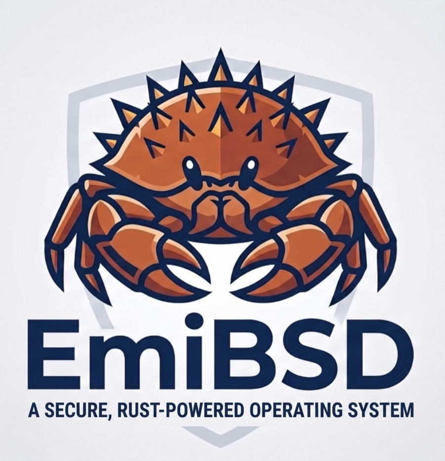
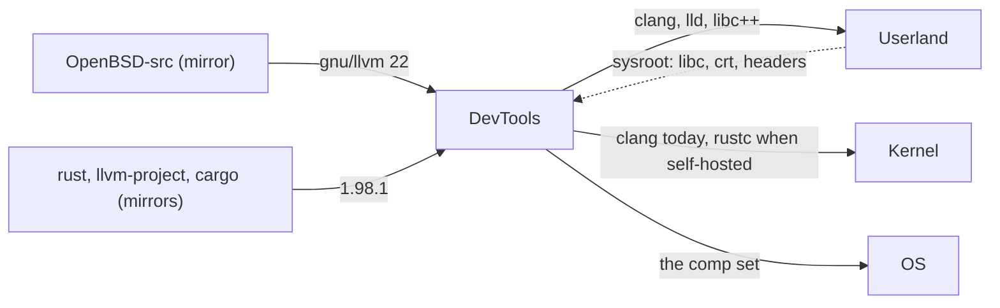

# EmiBSD DevTools

<p align="center">
  
</p>

<p align="center"><em>Ferffy, the EmiBSD mascot: a <a href="https://en.wikipedia.org/wiki/Lithodes_santolla">centolla</a>, the child of Ferris (Rust's crab) and Puffy (OpenBSD's pufferfish).</em></p>

<p align="center"><strong>The toolchains of EmiBSD, imported and built once: OpenBSD's LLVM for the C, a pinned stable Rust for the rest.</strong></p>

<p align="center">
  <a href="LICENSE"></a>
  <a href="rust-toolchain.toml"></a>
  <a href="#milestones"></a>
  <a href="#milestones"></a>
  <a href="https://www.emibsd.org"></a>
</p>

> **Not for production.** EmiBSD is an experiment. It runs only in QEMU, and its crypto,
> network and storage code is unaudited. Do not use it to protect real data or real networks.

The toolchains of [EmiBSD](https://www.emibsd.org), both imported and built once for every
repository that needs them:

- **`llvm/`**: LLVM as OpenBSD ships it, from the `gnu/llvm` tree of the pinned OpenBSD
  source with OpenBSD's patches and build glue: clang, lld, libc++, libc++abi, compiler-rt.
  Apache-2.0 with the LLVM exception. The compiler of the C.
- **`rust/`**: rust-lang/rust at a pinned stable tag, built with `x.py` and its own LLVM
  submodule: rustc, cargo, and `std` for `aarch64-unknown-openbsd`, a tier 3 target that this
  way gets its standard library from a stable release's source, without nightly. Apache-2.0
  and MIT.

Nothing here is written code. The sources come from read-only mirrors in the organisation
(`OpenBSD-src`, `rust`, `llvm-project`, `cargo`), pinned in each `UPSTREAM.toml`; what is ours
is the build glue, the patches with their reasons, and the artifacts.

EmiBSD is not affiliated with or endorsed by the OpenBSD project, the LLVM project or the
Rust project.

## Where it sits



The whole picture is in [Governance](https://github.com/EmiBSD/Governance),
`docs/architecture.md`; this repository exists by its decision G-0012.

## Milestones

| | Scope | Proof | State |
|---|---|---|---|
| T0 | the repository, the pins moved from `Userland/compiler/`, the tools, the mirror check | `just check` green | met 2026-10-31 |
| T1 | OpenBSD's LLVM built here for arm64 on the macOS host; Kernel's `just comp` glue moved | Kernel's `smoke-cc` and `smoke-install` pass with this clang | |
| T2 | rustc with `x.py`, macOS host, target `aarch64-unknown-openbsd`, Userland's sysroot | a static Rust hello runs under Kernel in QEMU | |
| T3 | GitHub releases: one tarball per host with `.sha256`; consumers fetch by pin | Userland's `just toolchain` installs it | |
| T4 | self-hosted: rustc built on EmiBSD with T3 as stage0 | after Kernel's N9 | |

## Using it

```
just status          # the two toolchains, their STATUS and version
just mirror-check    # every pin exists on its mirror and its origin with the same hash
just outdated        # is any pin behind its upstream's latest release? (the daily workflow files an issue)
just fetch           # clone the pinned sources into upstream/ (network)
just fetch-check     # the fetched sources match the pins
just build llvm      # build one toolchain into target/ (long: built once, cached)
just check           # what costs nothing: pins, mirrors, scripts
```

`docs/TOOLCHAIN.md` has the hosts, the targets, the stage0 chain and the artifact format.

## Licence

The build glue, the patches and the documents are ISC ([LICENSE](LICENSE)). The toolchains
keep their own licences, in their sources.
