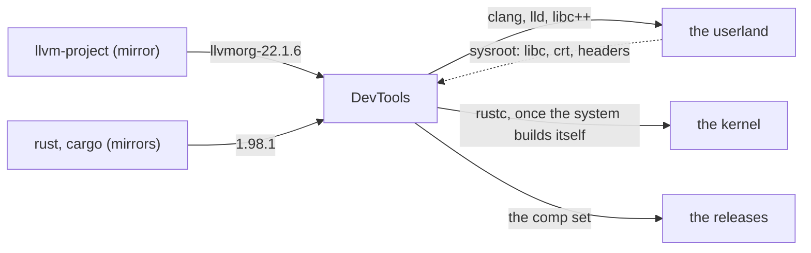

# EmiBSD DevTools

<p align="center">
  
</p>

<p align="center"><em>Ferffy, the EmiBSD mascot: a <a href="https://en.wikipedia.org/wiki/Lithodes_santolla">centolla</a>, the child of Ferris (Rust's crab) and Puffy (OpenBSD's pufferfish).</em></p>

<p align="center"><strong>The toolchains of EmiBSD, imported from the forks and built once: upstream LLVM for the C and for rustc, a pinned stable Rust.</strong></p>

<p align="center">
  <a href="LICENSE"></a>
  <a href="rust-toolchain.toml"></a>
  <a href="#milestones"></a>
  <a href="#milestones"></a>
  <a href="https://www.emibsd.org"></a>
</p>

> **Not for production.** EmiBSD is an experiment. It runs only in QEMU, and its crypto,
> network and storage code is unaudited. Do not use it to protect real data or real networks.

The toolchains of [EmiBSD](https://www.emibsd.org), both imported, both from the forks alone,
built once for every repository that needs them:

- **`llvm/`**: upstream LLVM at the tag `llvmorg-22.1.6`, from the fork `EmiBSD/llvm-project`,
  built with its own CMake: clang, lld, the tools, and compiler-rt, libunwind, libc++abi and
  libc++ for `aarch64-unknown-emibsd`, the target our patch series teaches it (decision
  D-0004). Apache-2.0 with the LLVM exception. The one compiler
  of the system, and the backend of rustc.
- **`rust/`**: rust-lang/rust at a pinned stable tag, built with `x.py` against `llvm/`:
  rustc, cargo, and `std` for `aarch64-unknown-emibsd`, a tier 3 target that this way gets
  its standard library from a stable release's source, without nightly. Apache-2.0 and MIT.

Nothing here is written code, and nothing of it comes from OpenBSD (decision D-0003 of
`docs/DECISIONS.md`). The sources come from the read-only mirrors `llvm-project`, `rust` and
`cargo`, pinned in each `UPSTREAM.toml`; what is ours is the build scripts, the patches and
the artifacts.

The build scripts, the documents and the commits of this repository are written by Claude
Code agents under its written rules (`CLAUDE.md`, `.claude/rules/`); the maintainer, Emilio
Navarrete Lineros, takes every decision and approves every commit (`docs/POLICIES.md`).

EmiBSD is not affiliated with or endorsed by the OpenBSD project, the LLVM project or the
Rust project.

## Where it sits



DevTools knows nothing of its consumers' internals: it takes a sysroot as an input and
publishes artifacts with checksums. `docs/TOOLCHAIN.md` has the inputs, the outputs, the
hosts and the chain; `docs/DECISIONS.md` why the repository exists (D-0002) and why nothing
of OpenBSD is in it (D-0003).

## Milestones

| | Scope | Proof | State |
|---|---|---|---|
| T0 | the repository, the pins, the tools, the mirror check | `just check` green | met 2026-10-31 |
| T1 | upstream LLVM 22.1.6 built from the fork with CMake on the macOS host: the host tools, then the target runtimes | a C and a C++ hello compiled for the target run under the EmiBSD kernel in QEMU | built and checked on the host 2026-10-31 (`llvm/tests/check.sh`); the QEMU run pending |
| T2 | rustc with `x.py` against T1's LLVM, macOS host, target `aarch64-unknown-emibsd` (decision D-0004: its target spec and `std` paths as `rust/patches/`), the userland's sysroot | a static Rust hello runs under the EmiBSD kernel in QEMU | |
| T3 | GitHub releases: one tarball per host with `.sha256`; consumers fetch by pin | a consumer's toolchain recipe installs it from the release | |
| T4 | self-hosted: rustc built on EmiBSD with T3 as stage0 | after the kernel's N9, when no inherited tree is left | |

## Using it

```
just status          # the two toolchains, their STATUS and version
just mirror-check    # every pin exists on its mirror and its origin with the same hash
just outdated        # is any pin behind its upstream's latest release? (the daily workflow files an issue)
just fetch           # clone the pinned sources into upstream/ (network)
just fetch-check     # the fetched sources match the pins
just build llvm      # build one toolchain into target/ (long: built once, cached)
just check           # what costs nothing: pins, mirrors, scripts
```

`docs/TOOLCHAIN.md` has the hosts, the targets, the stage0 chain and the artifact format;
`docs/DECISIONS.md`, `docs/POLICIES.md` and `docs/PROCESS.md` the rules the repository
works under. It carries all of them itself and cites no other repository's files.

## Licence

The build scripts and the documents are ISC ([LICENSE](LICENSE)). The toolchains keep their
own licences, in their sources.
