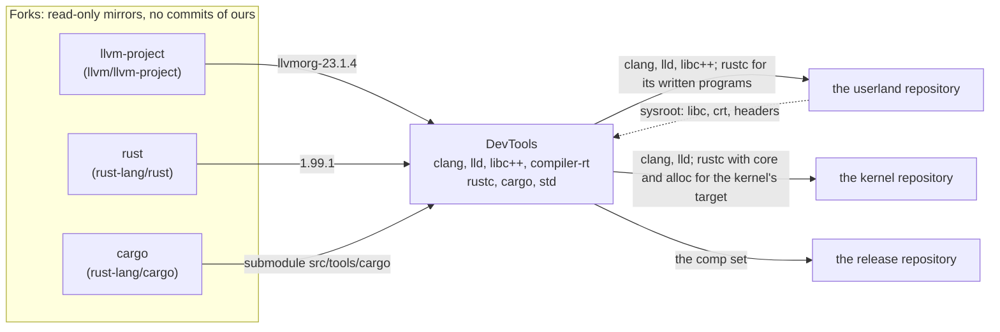

# The toolchains: hosts, targets, the chain, the artifacts

## One LLVM (decision D-0003)

| | Version | From | Builds |
|---|---|---|---|
| `llvm/` | `llvmorg-23.1.4` | the fork `EmiBSD/llvm-project` at upstream's tag, as upstream ships it | clang, lld, the tools; compiler-rt, libunwind, libc++abi, libc++ for `aarch64-emibsd-emibsd8.0` (our patch series, D-0004) |

It compiles the C and C++ of the system and it is the backend rustc builds against
(rustc 1.99.1 needs LLVM 21 or newer). Nothing of OpenBSD enters DevTools: no LLVM code, no
patches, no build glue. rustc's own `src/llvm-project` submodule is not fetched.

## Where it sits

| Flow | What | Why |
|---|---|---|
| mirrors to DevTools | rust-lang/rust at the pinned stable tag with its `cargo` submodule; upstream LLVM at `llvmorg-23.1.4` | the only inputs; nothing comes from OpenBSD (D-0003); one LLVM, built with its own CMake, for the C and for rustc's backend |
| DevTools to the userland | clang, lld and libc++; the Rust cross toolchain when a program written for EmiBSD exists | one toolchain for the whole base system; what OpenBSD's build glue passed to its own patched clang is adapted there, where that C is built |
| DevTools to the kernel | rustc with `core` and `alloc` for `aarch64-unknown-none-softfloat`, clang and lld for its assembly and the programs its smokes run (T1, T2; D-0006) | one toolchain for the kernel as for the userland; the kernel's `rust-toolchain.toml` names the same stable version |
| the userland to DevTools (dotted) | the sysroot: libc, crt, headers, by path (`EMIBSD_SYSROOT`) | a binary the toolchain produces needs a libc; `std`'s rlibs compile without one, so the cycle breaks there |
| DevTools to the release repository | the comp set: the artifacts by pin and checksum | it assembles and releases; it builds nothing of its own |

DevTools reads nothing of the three: no source, no rules, no logs (D-0005). What it knows of
them is in this table.

## Hosts and targets

| Host | Target (LLVM's triple; Rust's name is `aarch64-emibsd-emibsd`, `llvm-target` the triple) | When | Stage0 for `rust/` |
|---|---|---|---|
| `aarch64-apple-darwin` | `aarch64-emibsd-emibsd8.0` | T1, T2: the development machine | rustup's 1.99.1 (`rust-toolchain.toml`) |
| `x86_64-unknown-linux-gnu` | `aarch64-emibsd-emibsd8.0` | only if a consumer's CI needs it (open decision) | rustup's |
| `aarch64-emibsd-emibsd8.0` | itself | T4, after the kernel's milestone N9 (no inherited tree left) | the previous DevTools release |

amd64 as a target waits for the kernel's milestone N10 (decision D-0001). The target is
EmiBSD's own, taught to each toolchain by our patch series (decision D-0004): LLVM's in
`llvm/patches/`, Rust's in `rust/patches/` at T2.

## Inputs a build takes

| Variable | Meaning | Default |
|---|---|---|
| `EMIBSD_SYSROOT` | the target's libc, crt, headers, for LLVM's stage 2 and for linking Rust programs: a directory given by path, produced by the userland repository (until it exists, the base sets the kernel boots) | none: the build refuses to guess |
| `COMP_JOBS` | parallel jobs | 6 |
| `SOURCE_DATE_EPOCH` | the commit's time, for reproducible archives | set by the justfile |

Host tools: CMake, Ninja, Python 3, the host's C++ compiler (Apple clang on the Mac).
Installing any of them is the user's.

## The chain

1. **T1.** `llvm/build/build.sh`: stage 1 the host tools, stage 2 the target runtimes
   (`llvm/DESIGN.md`). Proof: a C hello and a C++ hello, compiled for the target and run under
   the EmiBSD kernel in QEMU.
2. **T2.** `rust/build/build.sh` runs `x.py dist` with a `config.toml` that names the host,
   the target `aarch64-emibsd-emibsd` (`llvm-target` `aarch64-emibsd-emibsd8.0`), `llvm-config` from T1, the linker (T1's lld), the
   sysroot, and `llvm.download-ci-llvm = false`; `core` and `alloc` for the kernel's
   `aarch64-unknown-none-softfloat` too (D-0006). `std`'s rlibs need no libc to compile; the
   hello needs the sysroot to link. The crates come vendored by `just fetch`; the mirrors
   `backtrace-rs` and `libc` are pinned to what the release fixes (`rust/DESIGN.md`).
3. **T3.** `just dist <name>`: `dist/<name>-<version>-<host>.tar.zst` and `.sha256`, one
   directory inside with the install tree, `MANIFEST` (commit, tag, pins, the patch series
   with its sums) and `share/doc/emibsd/` (the licences, the patches); reproducible (entries
   sorted, `SOURCE_DATE_EPOCH` the commit's time, uid and gid 0, modes normalised), then
   unpacked elsewhere and `tests/check.sh` run there, so the artifact is known to work away
   from `target/`. `just release <name>`, the maintainer's: from HEAD tagged
   `<name>-<version>` (`llvm-23.1.4+emibsd.1`), the GitHub release with the tarball, its sum
   and notes. A consumer's recipe downloads by that tag and verifies the sum before it
   unpacks; nothing is fetched as "latest". Signed with signify when the userland ships it.
4. **T4.** The same `x.py` on EmiBSD, stage0 the T3 artifact for `aarch64-emibsd-emibsd8.0`.
   From then on each release builds from the previous one; the first cross-built one is the
   root of trust and is recorded here with its hash.

## Versions

`<upstream version>+emibsd.<N>`: the upstream's version and our patch level, as
`UPSTREAM.toml` carries it (`23.1.4+emibsd.1`, `1.99.1+emibsd.1`). A pin bump is its own
commit; `N` resets to 1 on a bump and rises with each change of ours at the same pin.
